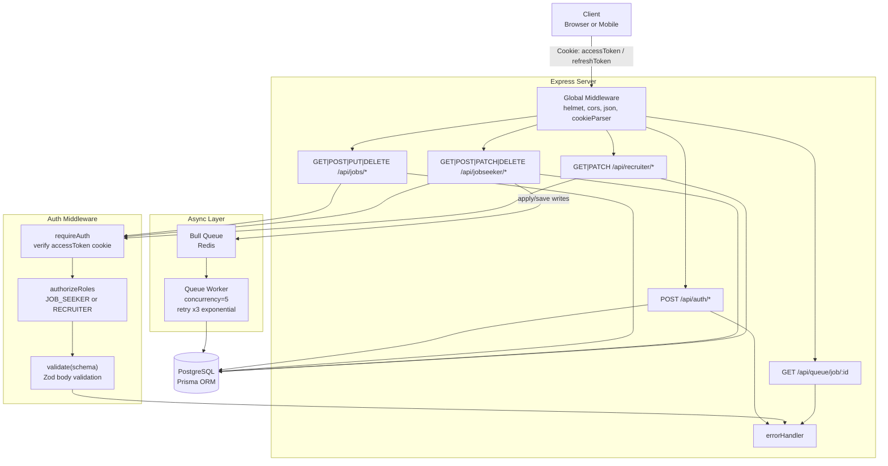
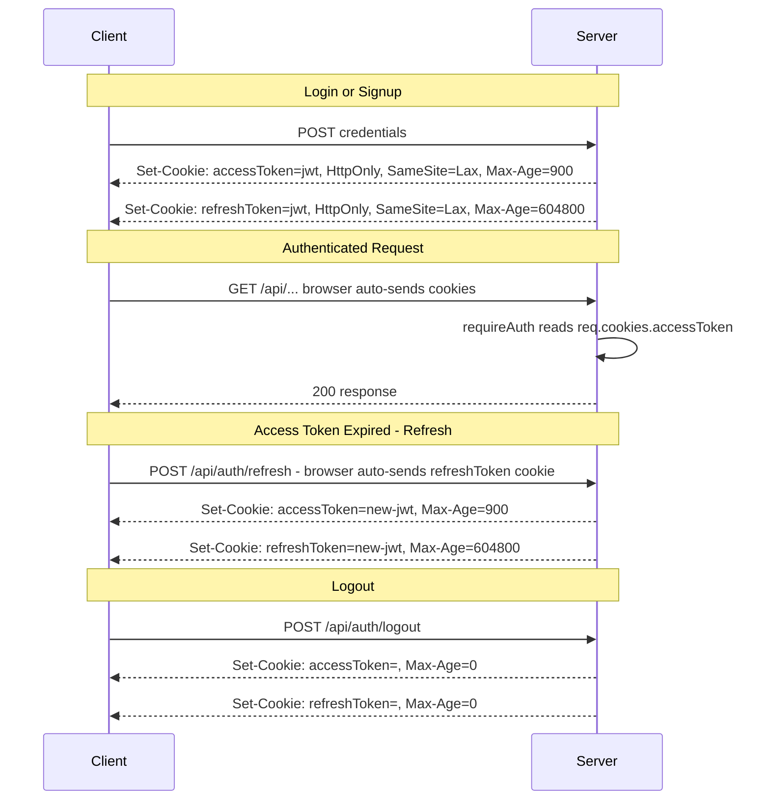

# Job Finder Backend – Process Diagrams Overview

This folder contains Mermaid sequence and flow diagrams for every process in the backend API.

---

## Document Index

| File | Contents |
|------|----------|
| [01-auth-flow.md](./01-auth-flow.md) | Signup (Job Seeker & Recruiter), Login, Logout, Token Refresh, Get Me, Upgrade to Recruiter |
| [02-jobs-flow.md](./02-jobs-flow.md) | Get All Jobs, Get Job by ID, Create / Update / Delete Job, Get Jobs by Recruiter |
| [03-jobseeker-flow.md](./03-jobseeker-flow.md) | Profile (get/update), Apply to Job (async), Get/Withdraw Applications, Save/Unsave/Get Saved Jobs |
| [04-recruiter-flow.md](./04-recruiter-flow.md) | Profile (get/update), Get Applications for Job, Update Application Status |
| [05-queue-flow.md](./05-queue-flow.md) | Queue architecture, payload types, poll job status, worker retry logic |
| [06-middleware-flow.md](./06-middleware-flow.md) | Global middleware stack, requireAuth, authorizeRoles, validate (Zod), error handler, cookie security table |

---

## High-Level Architecture

---

## Token / Cookie Flow Summary

