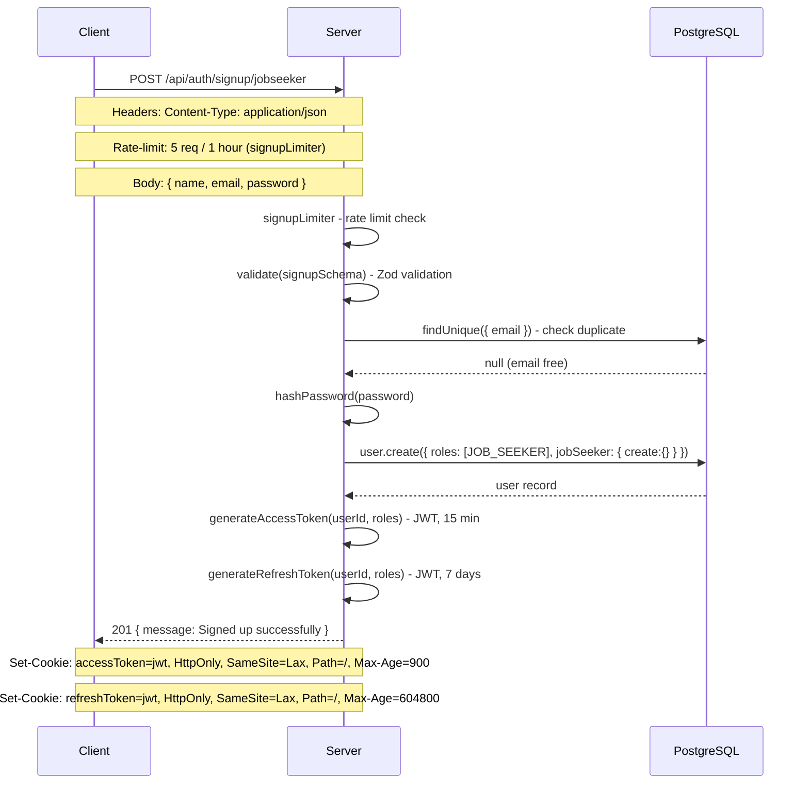
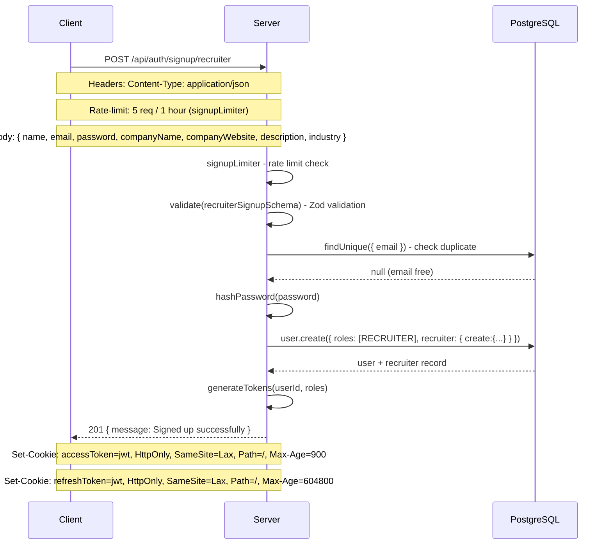
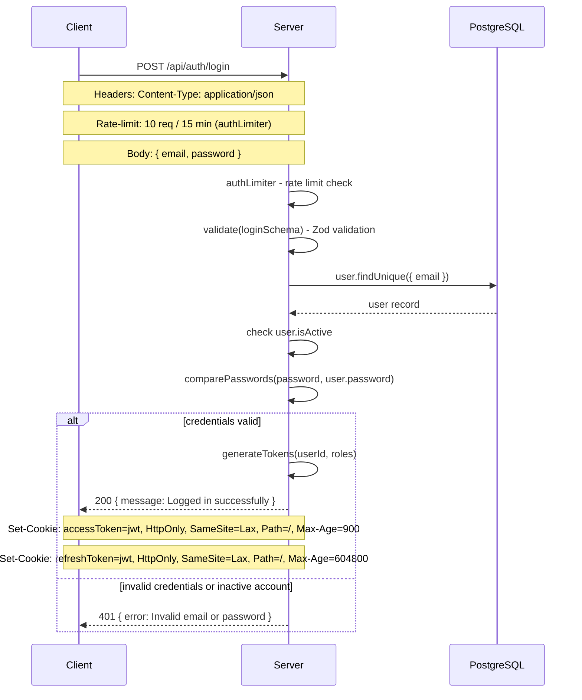
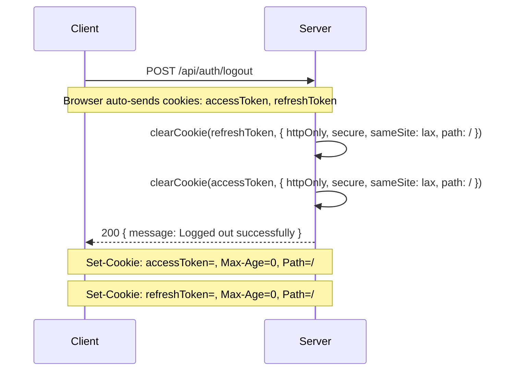
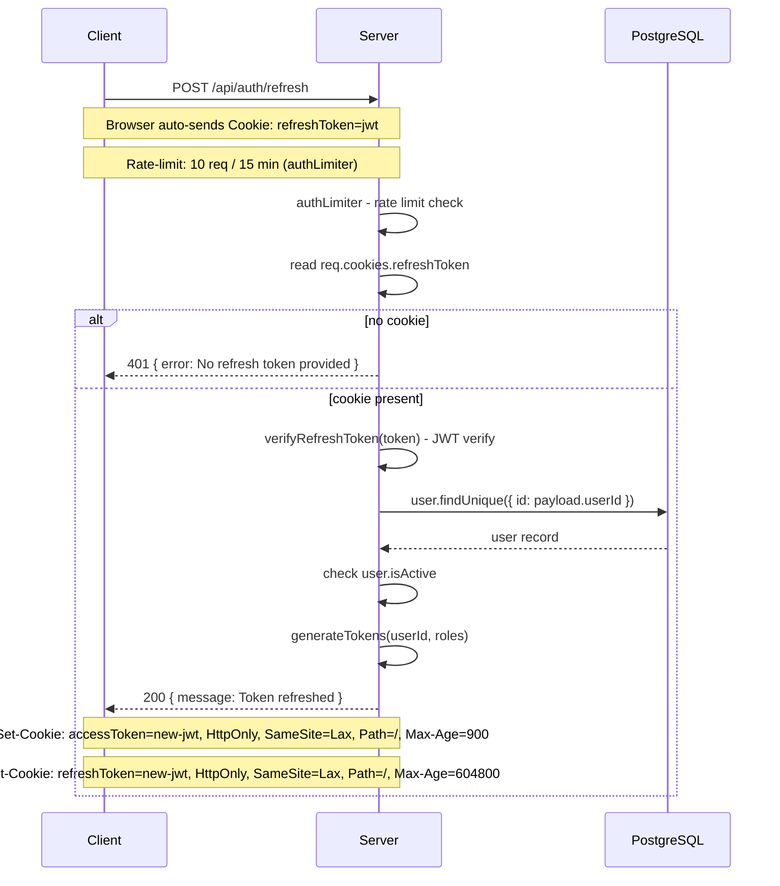
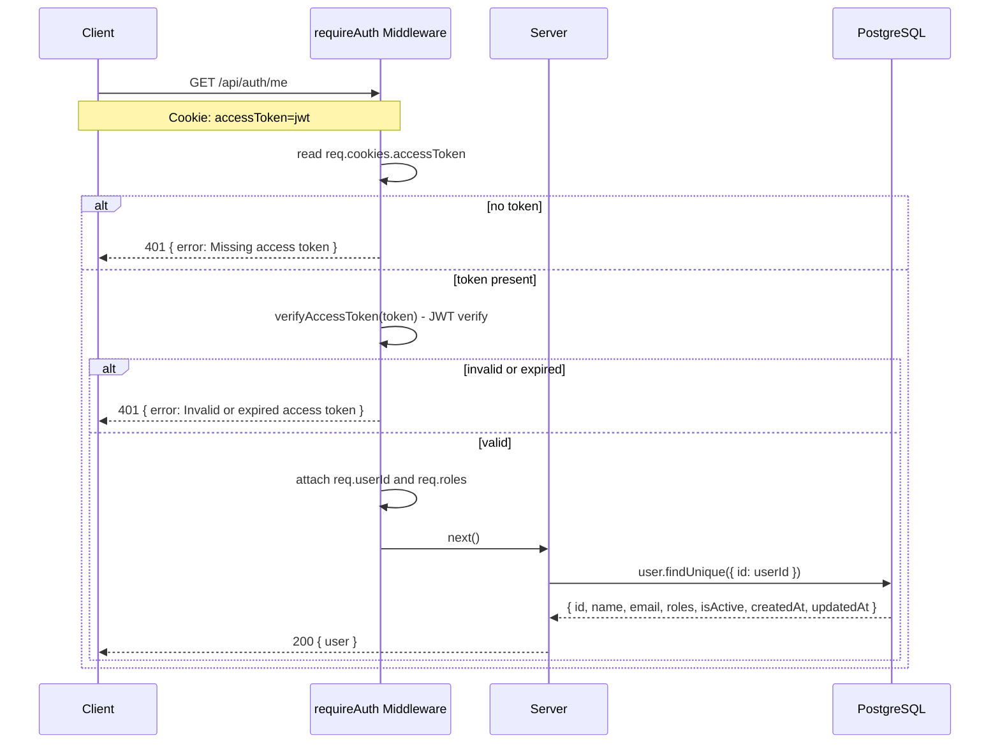
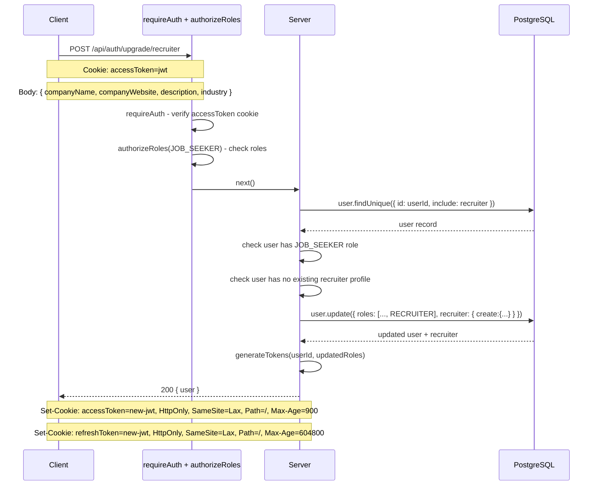

# Authentication Flow

## Signup – Job Seeker

---

## Signup – Recruiter

---

## Login

---

## Logout

---

## Token Refresh

---

## Get Current User

---

## Upgrade Job Seeker to Recruiter

