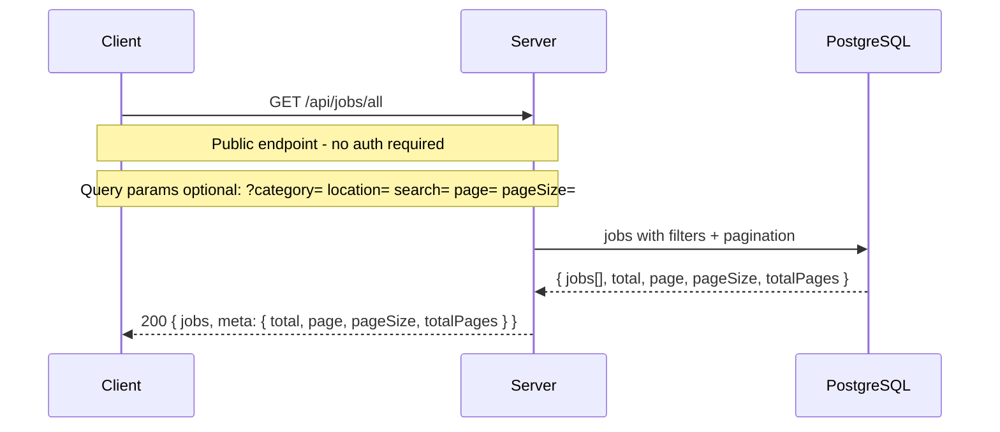
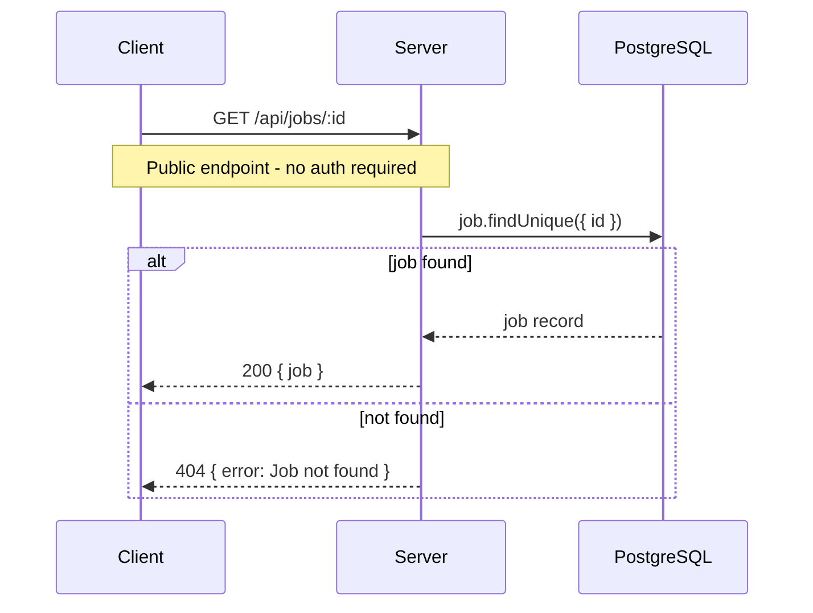
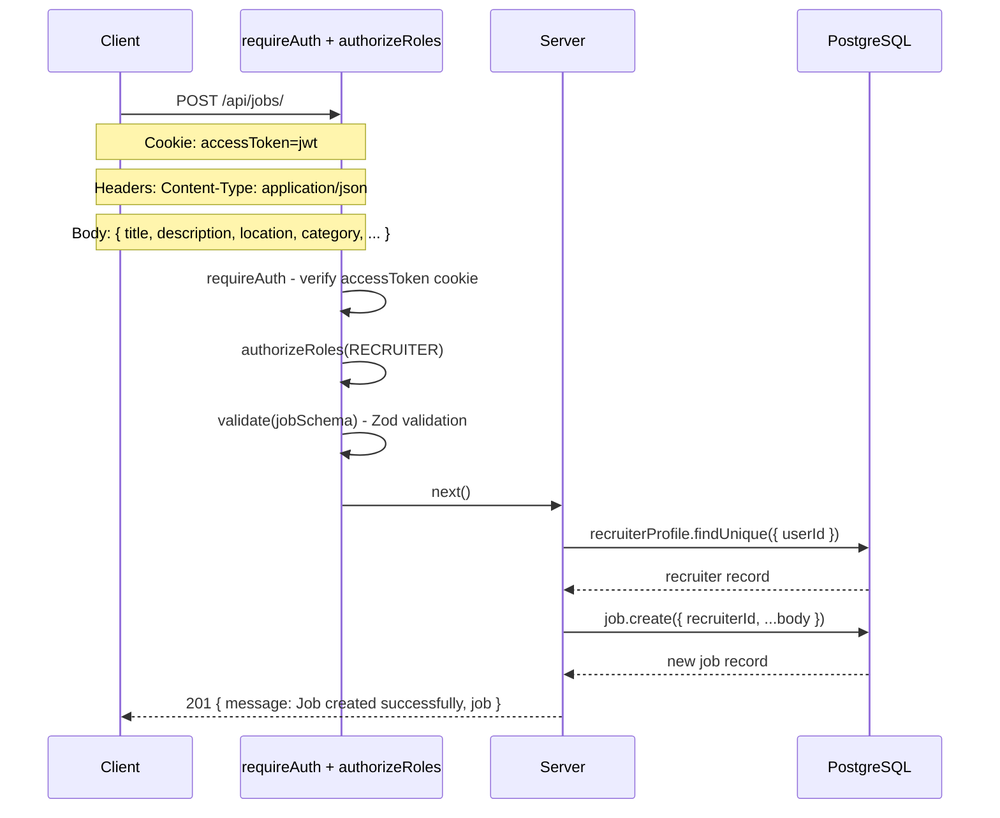
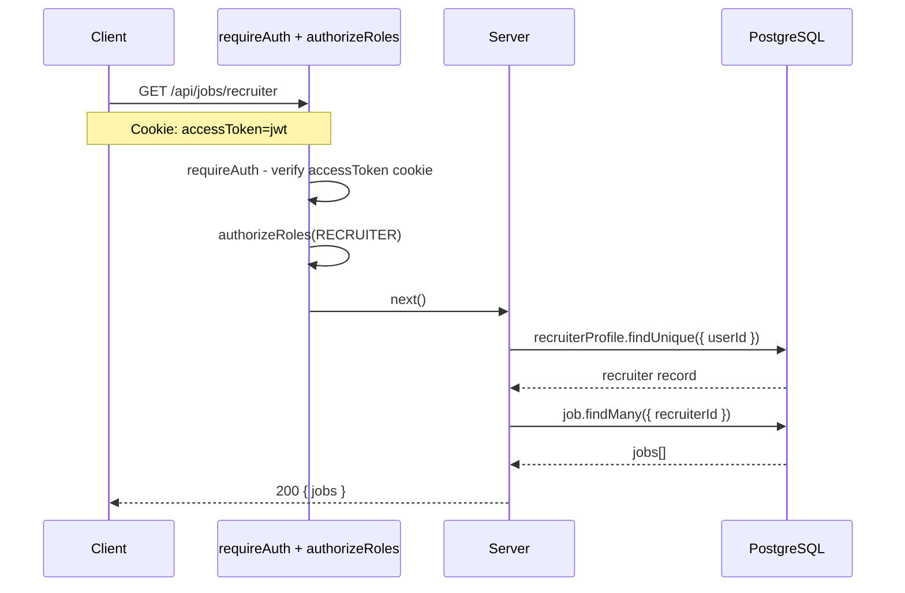
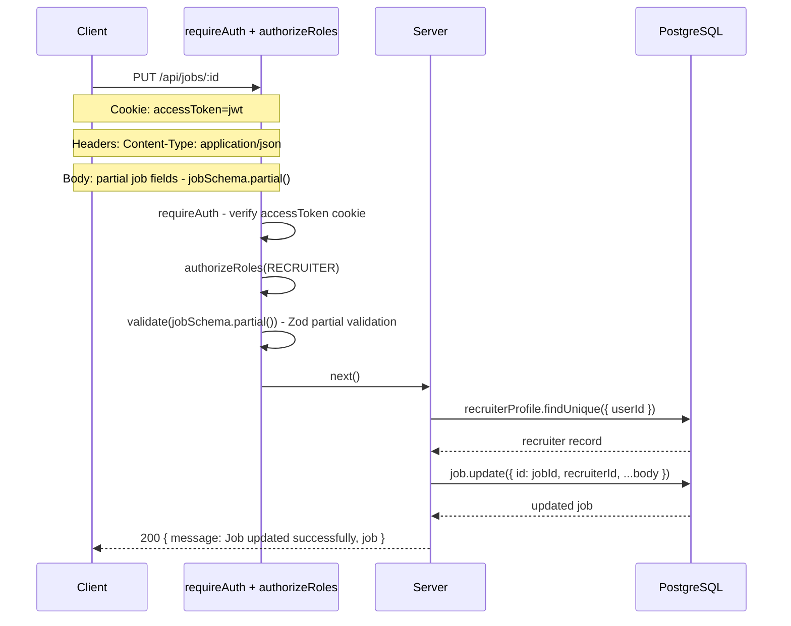
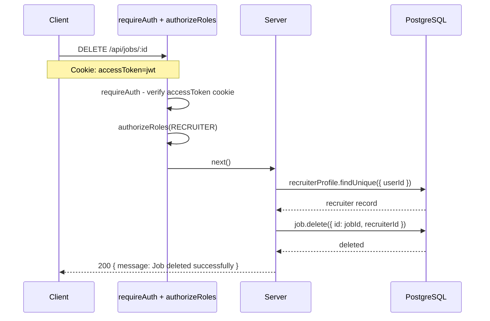

# Jobs Flow

> All protected routes require `Cookie: accessToken=jwt` (HTTP-only, set by login/signup).  
> The `requireAuth` middleware reads and verifies this cookie on every protected request.

---

## Get All Jobs (Public)

---

## Get Job by ID (Public)

---

## Create Job (Recruiter only)

---

## Get Jobs by Recruiter

---

## Update Job (Recruiter only)

---

## Delete Job (Recruiter only)

