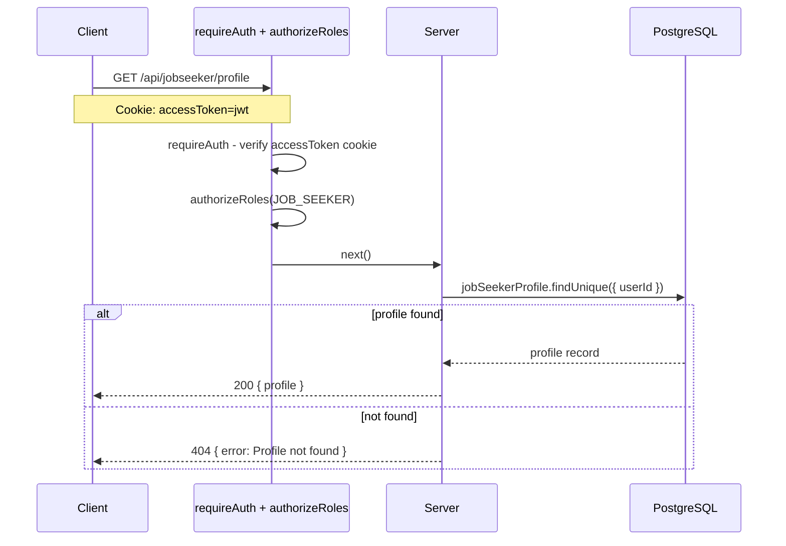
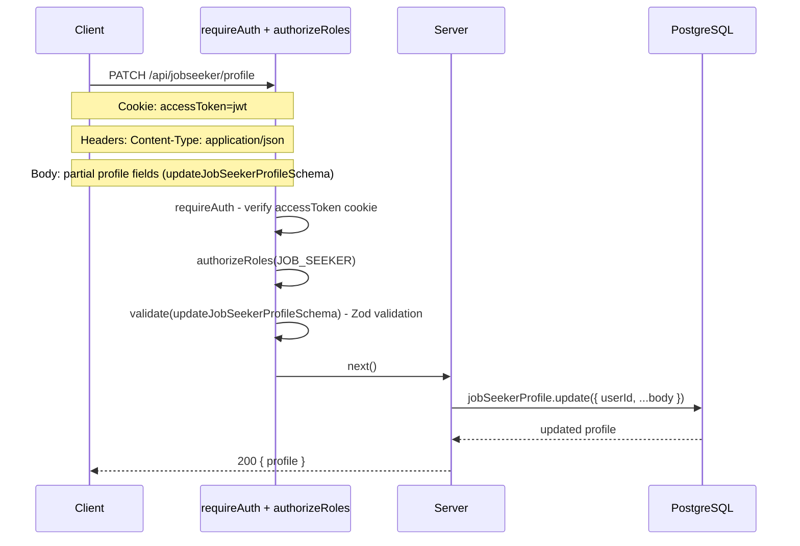
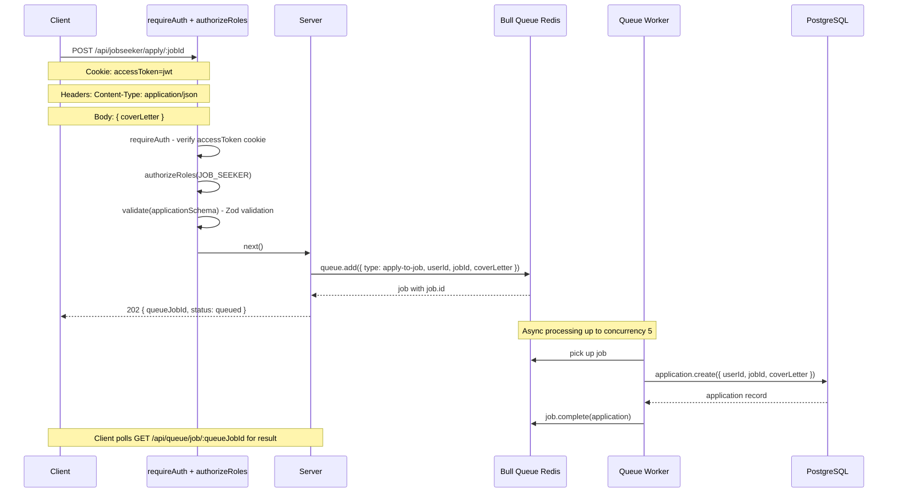
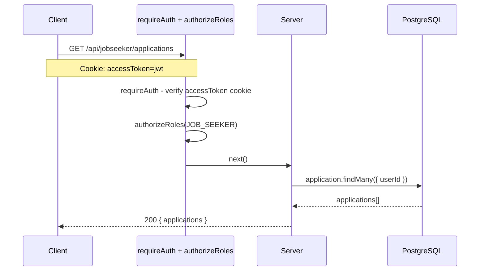
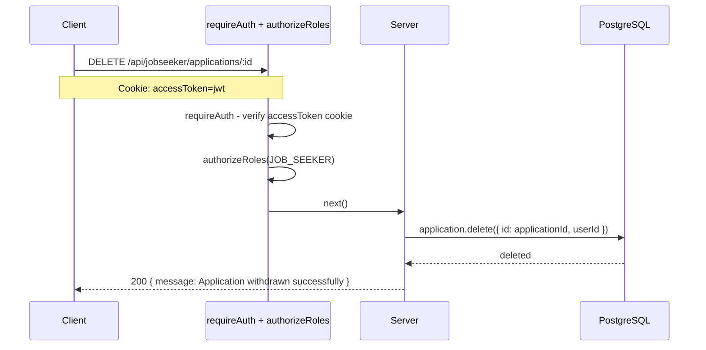
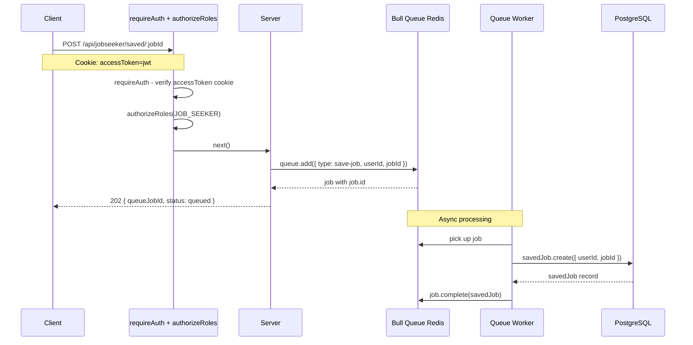
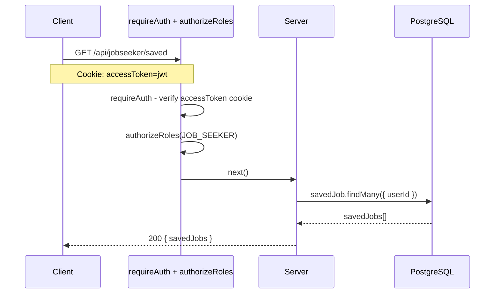
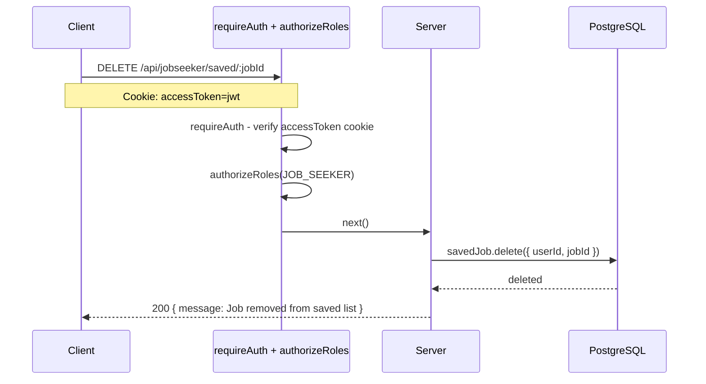

# Job Seeker Flow

> All routes require `Cookie: accessToken=jwt` (HTTP-only, set by login/signup) and `JOB_SEEKER` role.  
> Write operations (apply, save) go through the **Bull queue** (Redis) and return a `queueJobId` for polling.

---

## Get Profile

---

## Update Profile

---

## Apply to Job (async via Queue)

---

## Get Applications

---

## Withdraw Application

---

## Save Job (async via Queue)

---

## Get Saved Jobs

---

## Unsave Job

