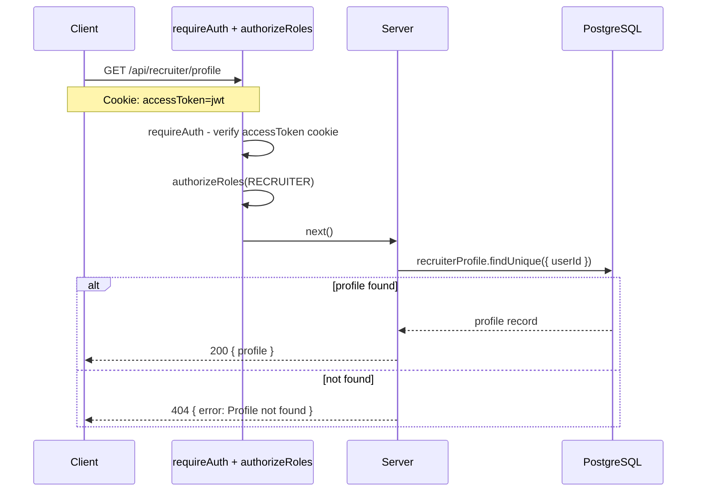
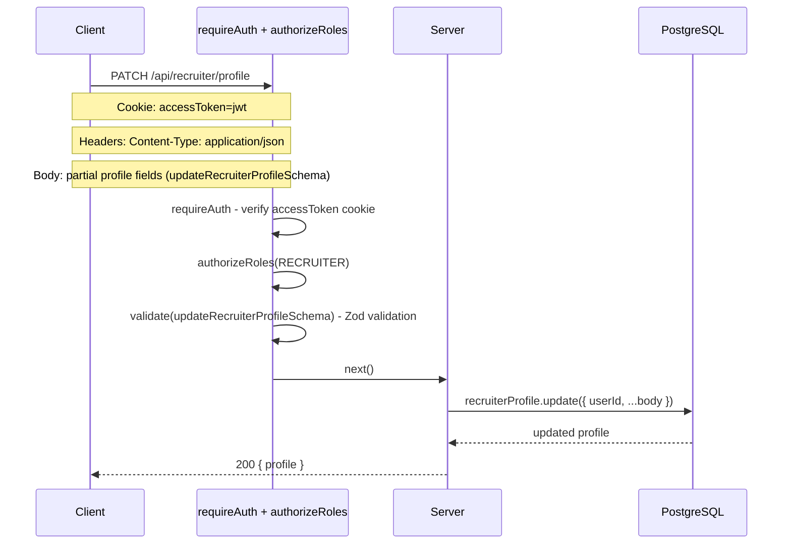
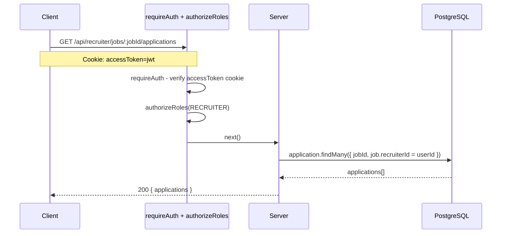
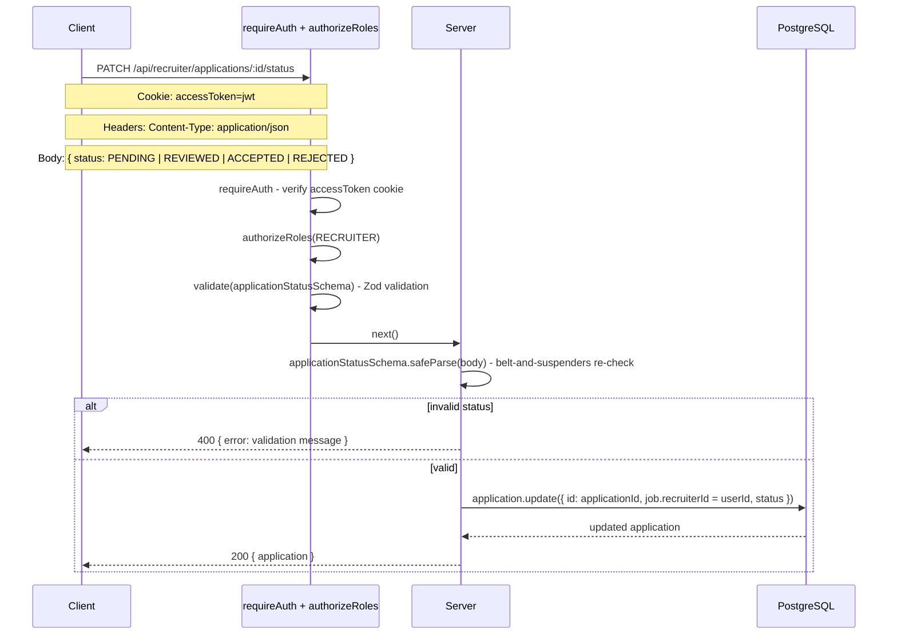

# Recruiter Flow

> All routes require `Cookie: accessToken=jwt` (HTTP-only, set by login/signup) and `RECRUITER` role.

---

## Get Recruiter Profile

---

## Update Recruiter Profile

---

## Get Applications for a Job

---

## Update Application Status

