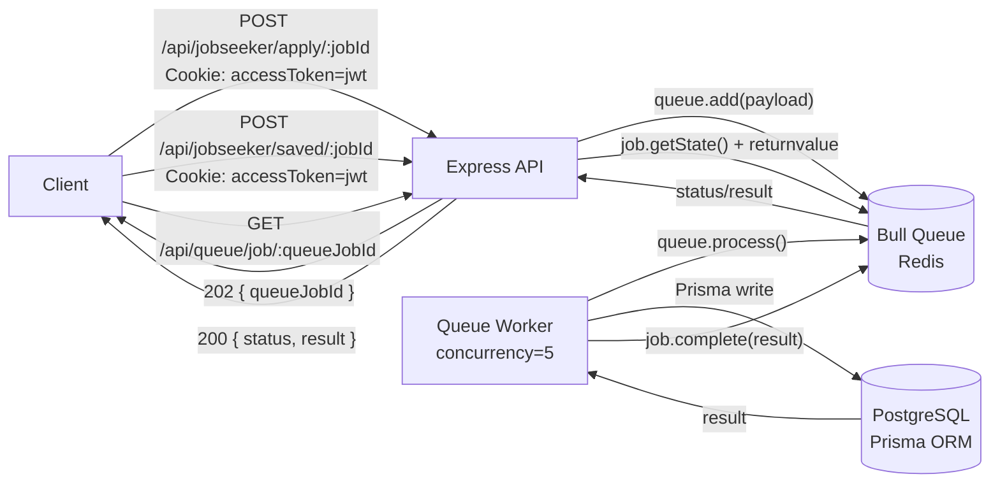
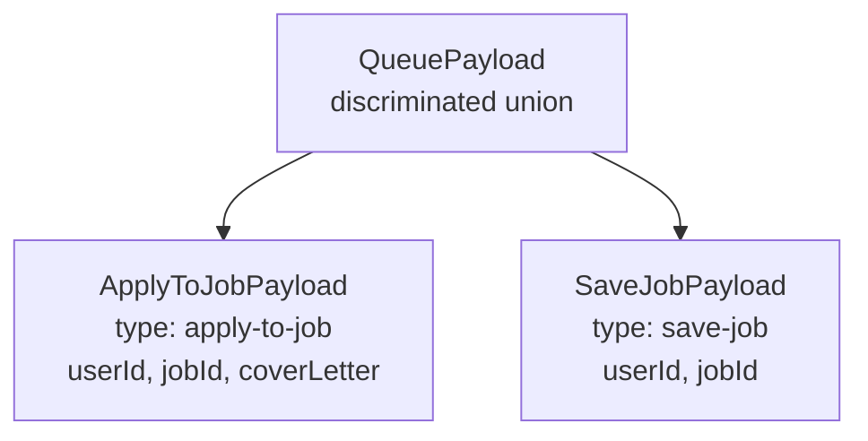
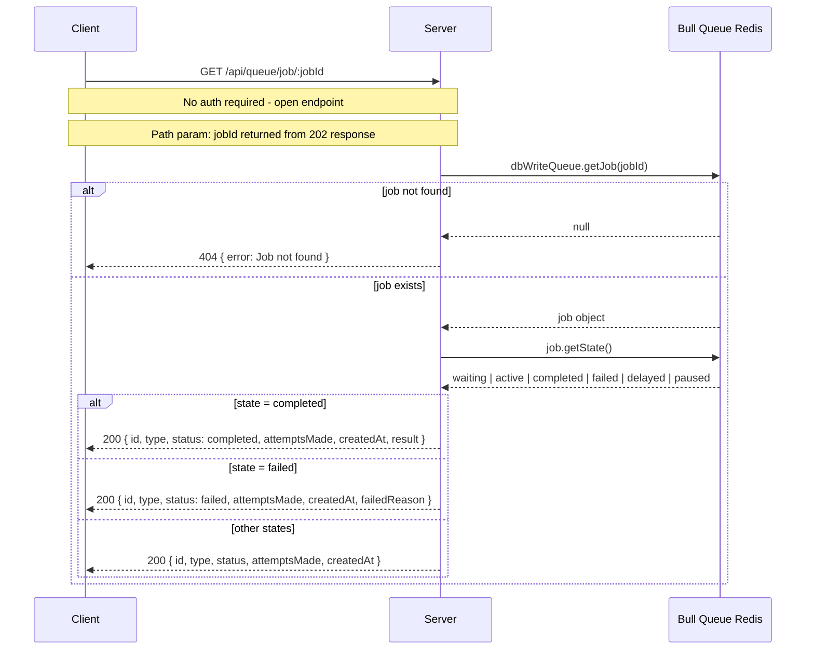
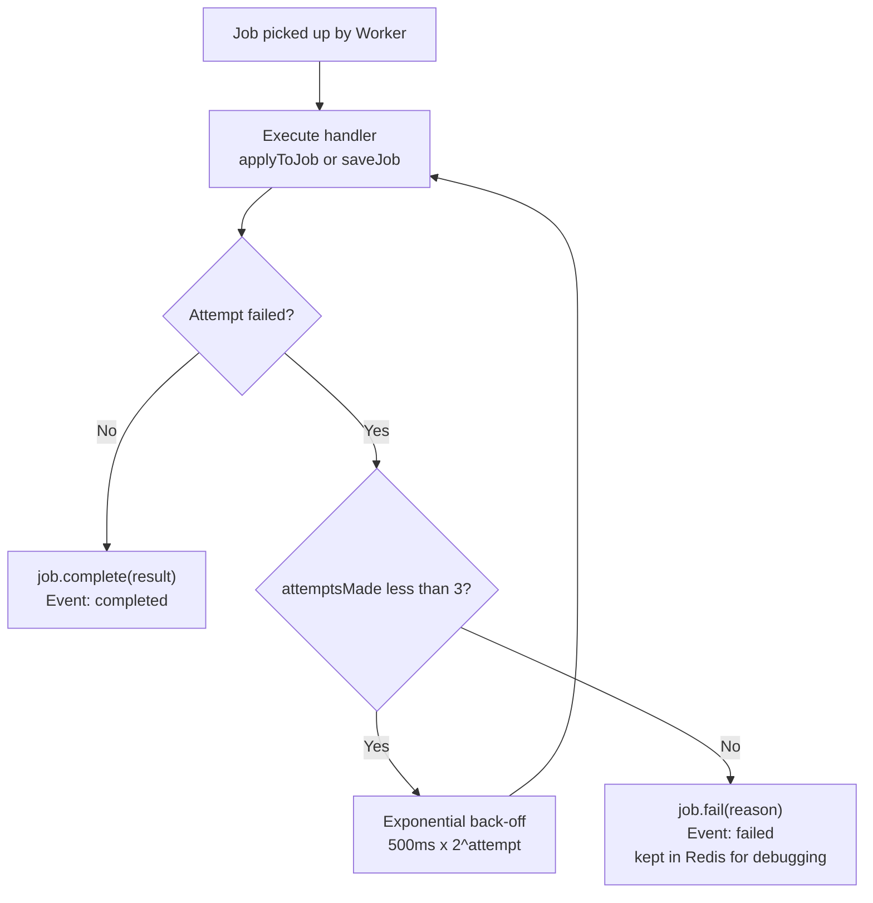

# Queue & Async Write Flow

> High-traffic write operations (apply to job, save job) are off-loaded to a **Bull queue** backed by Redis.  
> The queue uses exponential back-off (3 attempts, starting at 500 ms) and retains both completed and failed jobs so clients can poll their status.

---

## Queue Architecture Overview

---

## Queue Job Payload Types

---

## Poll Queue Job Status

---

## Worker Retry Logic

