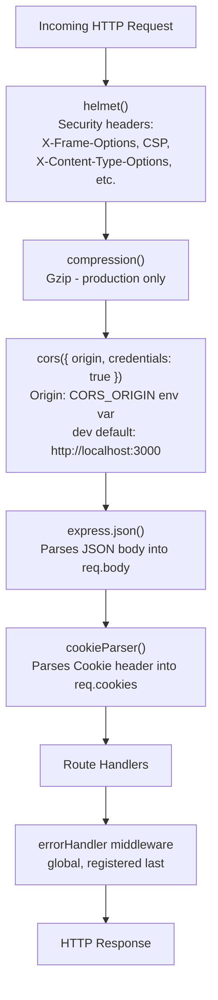
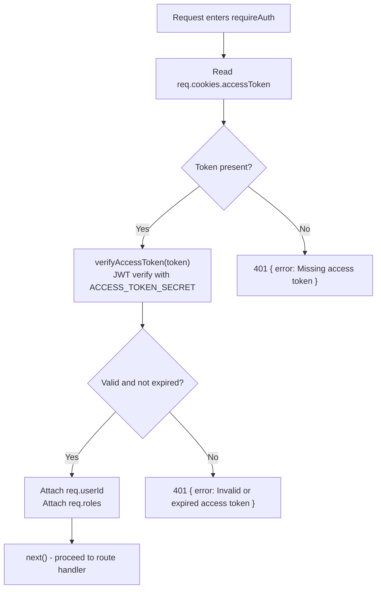
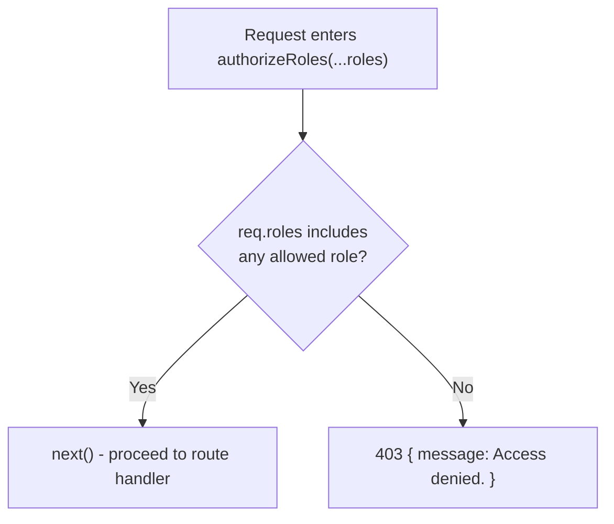
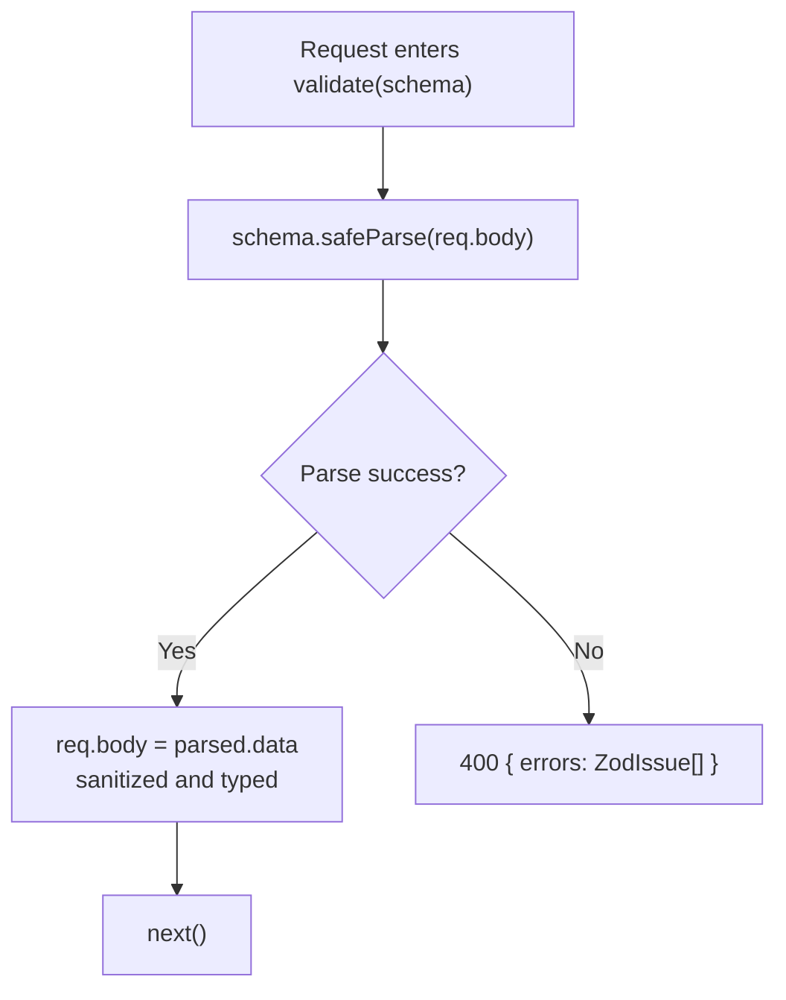
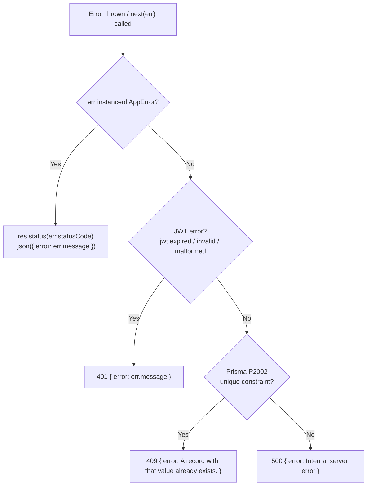

# Middleware & Request Lifecycle

## Global Middleware Stack

---

## requireAuth Middleware

---

## authorizeRoles Middleware

---

## validate Middleware (Zod)

---

## Error Handler Middleware

---

## Cookie Security Summary

| Cookie        | HttpOnly | Secure (prod) | SameSite | Path | Max-Age   |
|---------------|----------|---------------|----------|------|-----------|
| `accessToken` | ✅        | ✅             | `Lax`    | `/`  | 15 min    |
| `refreshToken`| ✅        | ✅             | `Lax`    | `/`  | 7 days    |

> **Why `SameSite=Lax`?**  
> Allows the cookie to be attached on top-level GET navigations from external origins (email magic-links, OAuth callbacks) while blocking cross-site state-mutating requests (POST/PUT/DELETE), striking the right balance between usability and CSRF protection.

> **Why `HttpOnly`?**  
> JavaScript cannot read these cookies, eliminating XSS-based token theft.
